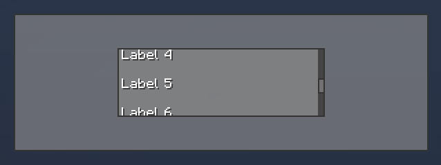
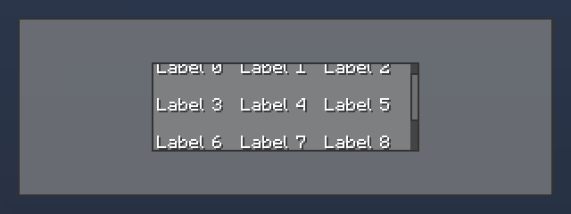

# ListView

## Features
* Displays a list of GuiElements in a specific layout and frame that can be scrolled.

## Variants
* `VerticalListView`
* `HorizontalListView`


---
### Usage
``` Java
public class MyElement extends GuiElement {
    private final ListView listView;
    public MyElement()
    {
        listView = new VerticalListView();
        Layout layout = new LayoutVertical();
        layout.stretchX = true; // will resize the childe's width
        listView.setLayout(layout);

        for(int i = 0; i < 10; i++)
        {
            Label label = new Label("Label " + i);
            label.setHeight(20);
            listView.addChild(label);
        }

        addChild(listView);
    }

    @Override
    protected void layoutChanged() {
        int width = getWidth();
        int height = getHeight();

        listView.setBounds(width/4, height/4, width/2, height/2);
    }
}
```


<tr>
<td>
<div align="center">
     
</div>
</td>

---
LayoutGrid is also supported
``` Java
public class MyElement extends GuiElement {
    private final ListView listView;
    public MyElement()
    {
        listView = new VerticalListView();
        LayoutGrid layout = new LayoutGrid(); // Use a grid layout
        layout.stretchX = true; // will resize the childe's width
        layout.columns = 3;
        listView.setLayout(layout);
        ...
    }
}
```

<tr>
<td>
<div align="center">
     
</div>
</td>

---
### Customisation
- `setScrollbarBackgroundColor(color)`
- `setScrollbarThickness(thickness)`

---
### Scroll position
The list keeps its scroll position when you clear it and add the elements again, for example when you rebuild the content
after new data arrived. The last offset set by the user or by `setScrollOffset(int)` is remembered and clamped to the new
content size, so the list does not jump back to the top.

Subclasses that change the content size themselves call the protected `clampScrollOffset()` afterwards; it derives the
current offset from the remembered one (`requestedScrollOffset`).


