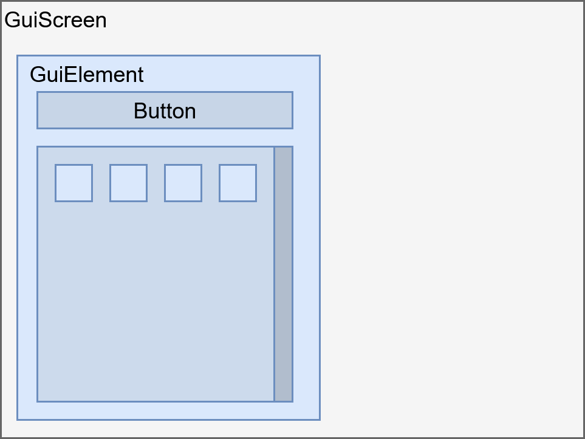

# GUI Library

## Overview

The GUI library is a fast and easy way to create screens in Minecraft. It uses a hierarchical tree structure to organize elements displayed on the screen. The library is designed to be compatible across multiple Minecraft versions, abstracting away version-specific GUI code changes.

Starting with v2.0.1, the GUI library core (`Gui`, `GuiElement`, all element subclasses) is **common code** that runs on both server and client. This enables rendering GUI elements on block faces via the DisplayBlock system, in addition to traditional Minecraft screens.

<tr>
<td>
<div align="center">
     
</div>
</td>

## Prerequisites

Before using the GUI library, you should understand:
- Basic Minecraft client-side screen concepts
- Component-based UI design patterns
- How to create and register network packets (if opening GUIs from server)

## Key Features

- Hierarchical element tree structure
- Cross-version compatibility
- Built-in layout management
- Pixel-snapped custom screen scale (`setGuiScale`, see [GuiScreen](GuiScreen.md#gui-scale))
- Debug visualization tools (F3-F6 keys)
- Rich set of pre-built components
- Custom element support
- **Render on block faces** via DisplayBlock (same elements work on screens and blocks)

## Migration Guide (v2.0.1)

### Package changes

Several classes have been moved to the `gui.client` package. **Update your imports** if you use any of these:

| Class | Old package | New package |
|---|---|---|
| `GuiScreen` | `net.kroia.modutilities.gui` | `net.kroia.modutilities.gui.client` |
| `GuiContainerScreen` | `net.kroia.modutilities.gui` | `net.kroia.modutilities.gui.client` |
| `ContainerView` | `net.kroia.modutilities.gui.elements` | `net.kroia.modutilities.gui.client` |
| `InventoryView` | `net.kroia.modutilities.gui.elements` | `net.kroia.modutilities.gui.client` |
| `Graphics` | `net.kroia.modutilities.gui` | Renamed to `ClientGraphics` in `net.kroia.modutilities.gui.client` |

### Removed classes

| Class | Replacement |
|---|---|
| `Graphics` | Use `ClientGraphics` from `gui.client` package |

### New classes

| Class | Package | Purpose |
|---|---|---|
| `IGraphics` | `net.kroia.modutilities.gui` | Rendering abstraction interface (common code) |
| `IInputProvider` | `net.kroia.modutilities.gui` | Input polling interface (common code) |
| `InputConstants` | `net.kroia.modutilities.gui` | Windowing-library-free key/mouse constants (common code), see [InputConstants](#inputconstants) |
| `ClientGraphics` | `net.kroia.modutilities.gui.client` | Screen rendering backend (replaces `Graphics`) |
| `ClientInputProvider` | `net.kroia.modutilities.gui.client` | Client `IInputProvider` backend (delegates to `InputCompat`; GLFW, or SDL3 from 26.3) |
| `WorldGraphics` | `net.kroia.modutilities.gui.client` | Block-face rendering backend |

### What stays the same

- `GuiScreen` API is unchanged (just update the import)
- `GuiContainerScreen` API is unchanged (just update the import)
- All element classes (`Button`, `Label`, `Slider`, `Plot`, `Frame`, etc.) remain in their original packages
- The `Gui` class API is unchanged for screen usage
- `updateLayout(Gui gui)` pattern is unchanged
- Element lifecycle (`init`, `render`, `layoutChanged`) is unchanged

### Quick fix for dependent mods

In most cases, a find-and-replace on imports is sufficient:

```
// Old imports
import net.kroia.modutilities.gui.GuiScreen;
import net.kroia.modutilities.gui.GuiContainerScreen;
import net.kroia.modutilities.gui.elements.ContainerView;
import net.kroia.modutilities.gui.elements.InventoryView;

// New imports
import net.kroia.modutilities.gui.client.GuiScreen;
import net.kroia.modutilities.gui.client.GuiContainerScreen;
import net.kroia.modutilities.gui.client.ContainerView;
import net.kroia.modutilities.gui.client.InventoryView;
```

## Content

### Core Classes
- [GuiScreen](GuiScreen.md) - Base screen implementation for standalone GUIs
- [GuiContainerScreen](GuiContainerScreen.md) - Screen implementation for inventory-based GUIs
- [GuiElement](GuiElement.md) - Base widget class for all GUI components

### Available GUI Elements

**Interactive Elements:**
  - [Button](GuiElements/Button.md) - Standard clickable button
  - [EmptyButton](GuiElements/EmptyButton.md) - Button without visual representation
  - [CloseButton](GuiElements/CloseButton.md) - Pre-configured close button
  - [CheckBox](GuiElements/CheckBox.md) - Toggle checkbox element
  - [HorizontalSlider](GuiElements/HorizontalSlider.md) / [VerticalSlider](GuiElements/VerticalSlider.md) - Value slider controls
  - [TextBox](GuiElements/TextBox.md) - Text input field
  - [DropDownMenu](GuiElements/DropDownMenu.md) - Selection dropdown

**Display Elements:**
  - [Label](GuiElements/Label.md) - Text display
  - [TextureElement](GuiElements/TextureElement.md) - Image/texture display
  - [Plot](GuiElements/Plot.md) - Data visualization chart
  - [ItemView](GuiElements/ItemView.md) - Single item display
  - [ContainerView](GuiElements/ContainerView.md) - Container/inventory display

**Container Elements:**
  - [Frame](GuiElements/Frame.md) - Generic container for grouping elements
  - [ListView](GuiElements/ListView.md) - Scrollable list container
  - [InventoryView](GuiElements/InventoryView.md) - Player inventory display
  - [ItemSelectionView](GuiElements/ItemSelectionView.md) - Item selection grid
  - [TabElement](GuiElements/TabElement.md) - Tabbed container
  - [ExpandablePanel](GuiElements/ExpandablePanel.md) - Collapsible container with a header

## Architecture

### Rendering backends

The GUI library uses an `IGraphics` interface to abstract rendering. Two backends are provided:

- **`ClientGraphics`** - Wraps Minecraft's `GuiGraphics` for screen rendering. Used automatically by `GuiScreen` and `GuiContainerScreen`.
- **`WorldGraphics`** - Renders to a framebuffer texture for block-face display. Used by the DisplayBlock system.

Both backends support the same GUI elements. Code that creates elements and builds layouts works identically for screens and blocks.

### Common vs client code

The GUI library is split into common code (runs on server + client) and client-only code:

**Common** (`net.kroia.modutilities.gui` and subpackages):
- `Gui`, `GuiElement`, all element subclasses
- `IGraphics`, `IInputProvider`, `InputConstants`
- Layout classes, geometry classes

**Client-only** (`net.kroia.modutilities.gui.client`):
- `GuiScreen`, `GuiContainerScreen`
- `ClientGraphics`, `ClientInputProvider`, `WorldGraphics`
- `ContainerView`, `InventoryView`

### InputConstants

`net.kroia.modutilities.gui.InputConstants` holds the key and mouse button constants that GUI element code compares against in `mouseClicked`, `keyPressed` etc. Every value is a compile-time alias of Minecraft's `com.mojang.blaze3d.platform.InputConstants`, so:

- the values always match the key codes Minecraft delivers on the running version, and
- common code can use them without loading the client-only Minecraft class at runtime (javac inlines the constants).

Available constants: `MOUSE_BUTTON_LEFT/RIGHT/MIDDLE`, `KEY_A`, `KEY_C`, `KEY_E`, `KEY_V`, `KEY_X`, `KEY_ESCAPE`, `KEY_ENTER`, `KEY_KP_ENTER`, `KEY_BACKSPACE`, `KEY_DELETE`, `KEY_SPACE`, arrow keys (`KEY_LEFT/RIGHT/UP/DOWN`), `KEY_PAGE_UP/PAGE_DOWN`, `KEY_HOME/END`, `KEY_F3`–`KEY_F6`, `KEY_LEFT_SHIFT/LEFT_CONTROL/LEFT_ALT`.

> **Never compare against raw key literals** (`keyCode == 32`, `button == 0`, `GLFW.GLFW_KEY_*`). Minecraft 26.3 replaced GLFW with SDL3, which changed every key code and mouse button number (e.g. the left mouse button is 1, not 0). Code that uses the named constants compiles and works unchanged on every supported version. If you need a key that is missing, add an alias to `InputConstants` instead of hard-coding the number.

**Ctrl shortcuts:** use `InputConstants.shortcutKey(keyCode, scanCode)` to detect select-all / copy / cut / paste. It returns the key that follows the printed letter of the user's keyboard layout (like vanilla's `EditBox`). Up to 26.2 it returns `keyCode` unchanged; on 26.3 it maps SDL3's layout key code, and returns `-1` if the physical A/C/V/X position carries another letter.

```java
@Override
protected boolean keyPressed(int keyCode, int scanCode, int modifiers) {
    if (isKeyPressed(InputConstants.KEY_LEFT_CONTROL)) {
        switch (InputConstants.shortcutKey(keyCode, scanCode)) {
            case InputConstants.KEY_A -> { selectAll(); return true; }
            case InputConstants.KEY_C -> { copy(); return true; }
        }
    }
    if (keyCode == InputConstants.KEY_ENTER || keyCode == InputConstants.KEY_KP_ENTER) {
        submit();
        return true;
    }
    return false;
}
```

For held-key queries, modifier state and mouse/cursor access from client code, use [`InputCompat`](../development/MultiVersionCompat.md#inputcompat).

### GuiElementRegistry

`net.kroia.modutilities.gui.GuiElementRegistry` maps a string type key to a factory for each `GuiElement` class. `Gui` uses it to serialize its element tree (type key, id, bounds, `serializeState()`, children) and to rebuild it from NBT. This is how [display block](DisplayBlock.md) GUIs are synced to clients and survive the client rebuilding the `Gui` (chunk reload, world rejoin): elements whose class is **not** registered are skipped during serialization and are missing after the rebuild.

The 16 built-in element types are pre-registered. Register your own element types once during mod initialization (common code, both sides):

```java
GuiElementRegistry.register("my_widget", MyWidget.class, MyWidget::new);
```

The factory must create an element with a no-argument default state; everything else is restored through `deserializeState(...)`. See [Display Block System](DisplayBlock.md#guielementregistry) for the full API.

## See Also

- [Documentation Index](../README.md) - Main documentation index
- [Sandbox System](../development/Sandbox.md) - GUI testing examples
- [Networking Library](../networking/Networking.md) - For opening GUIs from server
